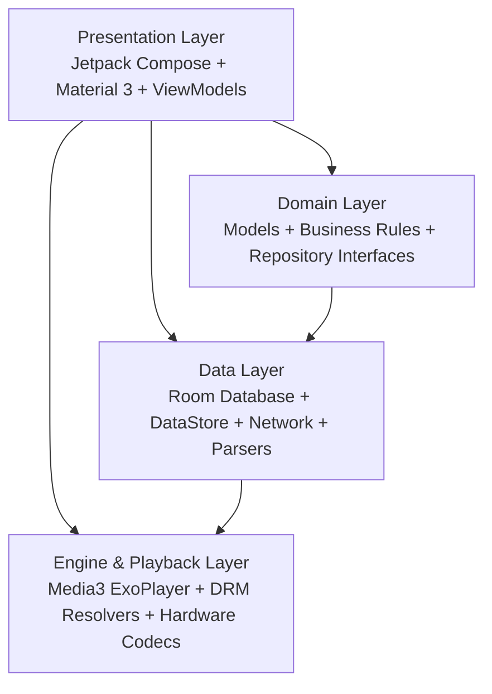
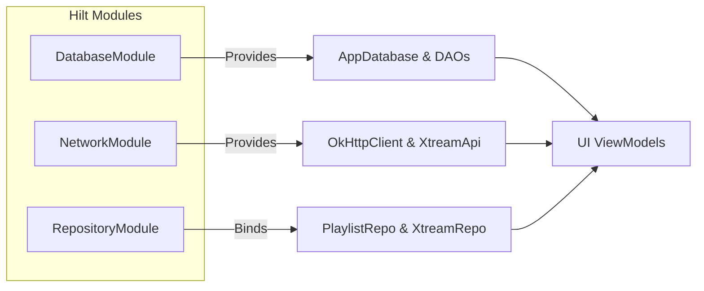
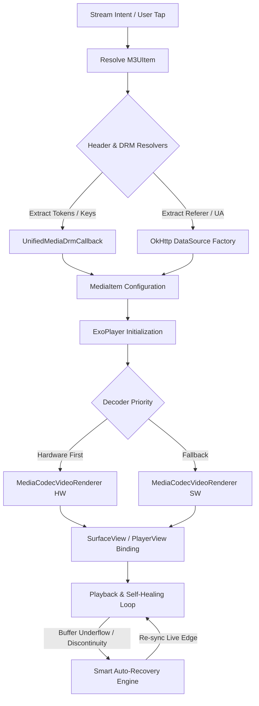

# StreamPlus System Architecture Documentation

## 1. Executive Summary

StreamPlus is a modern, high-performance Android media streaming application built on Jetpack Compose and AndroidX Media3 (ExoPlayer). It delivers unified playback capabilities for live IPTV streams (M3U, M3U8, HLS, MPEG-DASH, RTSP, SmoothStreaming), Xtream Codes API v2 services, and local device media (video and audio).

The architecture adheres to Google's official Android Architecture Guidelines, combining **Clean Architecture**, **MVVM (Model-View-ViewModel)**, and **Unidirectional Data Flow (UDF)** with asynchronous Kotlin Coroutines and reactive `StateFlow` primitives.

---

## 2. Architectural Pillars

### 2.1 Layered Separation of Concerns
1. **Presentation Layer (`com.codesrahul.streamplus.ui.*`)**:
   - Pure Declarative UI built with Jetpack Compose and Material 3.
   - Screen ViewModels manage UI state using `StateFlow` and handle user events via clean event handlers.
   - Shared Element Transitions and glassmorphic UI modifiers provide responsive aesthetic experiences across both phones and Android TV form factors.

2. **Domain Layer (`com.codesrahul.streamplus.domain.*`)**:
   - Represents the core domain entities: `M3UItem`, `StreamStatus`, `PlaylistRepository`, `XtreamRepository`.
   - Free from direct Android SDK dependencies, enabling straightforward unit testing and business rule enforcement.

3. **Data Layer (`com.codesrahul.streamplus.data.*`)**:
   - **Local Storage**: Room Persistence Library (`AppDatabase`, `ChannelDao`, `PlaylistDao`, `HistoryDao`).
   - **Preferences**: Jetpack DataStore Preferences (`SettingsRepository`, `AppSettings`).
   - **Network Stack**: OkHttp 4 with custom interceptors (`CrossDomainForwardingInterceptor`, `DynamicUrlInterceptor`), Retrofit 2 for Xtream REST endpoints.
   - **Parsing & Inspection**: Composite stream parsers (`StreamParserFactory`, `M3UStreamParser`, `JsonStreamParser`, `XmlPlsStreamParser`) and live stream sniffers (`StreamChecker`, `StreamIntelligenceEngine`).
   - **EPG Management**: `EPGManager` handles XMLTV gzip downloads, SAX/DOM schedule indexing, and time-shifted program matching.

4. **Media Engine Layer (`androidx.media3.*`, `UnifiedMediaDrmCallback`, `MediaCodecConfig`)**:
   - Built on AndroidX Media3 1.4.1 ExoPlayer.
   - Hardware-accelerated video decoding with fallback prioritization.
   - Multi-DRM resolution supporting Widevine (L1 and L3 forced fallback), ClearKey, and PlayReady.
   - System Cast Framework integration via `CastOptionsProvider`.

---

## 3. Dependency Injection Architecture (Hilt)

Dependency Injection is orchestrated by Dagger Hilt across application and activity lifecycles:

* **`DatabaseModule`**: Singleton provider for `AppDatabase`, `ChannelDao`, `PlaylistDao`, and `HistoryDao`. Uses Room database migration strategies and fast SQLite thread-safe connections.
* **`NetworkModule`**: Configures singletons for `OkHttpClient` with timeout policies, cross-domain header forwarders, and SSL trust managers when SSL verification bypass is explicitly enabled by the user.
* **`RepositoryModule`**: Binds domain repository interfaces to concrete implementations (`PlaylistRepositoryImpl`, `XtreamRepositoryImpl`).

---

## 4. Playback & Media Engine Architecture

### 4.1 DRM Resolution
`UnifiedMediaDrmCallback` orchestrates DRM license acquisition. It extracts custom license request headers (e.g., authorization bearer tokens, custom key IDs) and performs authenticated POST requests to remote license servers. When hardware security levels conflict with DRM licenses, the player supports forcing Widevine L3 security (`KEY_SECURITY_LEVEL = "L3"`).

### 4.2 Codec and Track Negotiation
* **Track Selector**: Utilizes `DefaultTrackSelector` with custom constraints for video resolution caps, preferred audio language matching, and subtitle format filtering.
* **Audio Boost**: High-gain audio processing using ExoPlayer's `SonicAudioProcessor` and software volume expansion for quiet broadcast channels.
* **Live Edge Alignment**: Automatically realigns HLS/DASH live stream edges when buffer underrun or broadcast delays accumulate.

---

## 5. Persistence & Data Modeling

### 5.1 Room Database Schema
* **`PlaylistEntity`**: Stores playlist metadata (title, target URL, server credentials, EPG URL, custom User-Agent, color, pin status, sorting weight).
* **`ChannelEntity`**: Stores indexed channel information (playlist reference, name, stream URL, logo URL, group title, EPG ID, DRM license scheme, custom HTTP headers map, VOD vs Live indicator).
* **`FavoriteEntity`**: High-performance channel bookmark index with cross-playlist identification.
* **`HistoryEntity`**: Playback history tracking last played position, watch duration, and access timestamp.

### 5.2 16 KB Page Alignment & Android 15 Compatibility
All native binary shared libraries (`.so`) are packaged uncompressed (`packaging.jniLibs.useLegacyPackaging = false`) and page-aligned to 16,384-byte boundaries (`data_offset % 16384 == 0`), ensuring zero-copy memory mapping (`mmap`) compatibility on Android 15 and 16 KB hardware architectures.

---

## 6. UI & State Management (MVI / UDF Pattern)

Each screen operates under Unidirectional Data Flow:
1. **State**: Represented by immutable data classes exposed as `StateFlow<UiState>`.
2. **Intent/Event**: User actions (click, scroll, search, delete) are dispatched as methods to the ViewModel.
3. **Reduction**: ViewModel interacts with Repositories inside `viewModelScope`, applying mutations to internal `MutableStateFlow` instances.
4. **Render**: Jetpack Compose observes state via `collectAsState()` and recomposes only the affected UI nodes.
