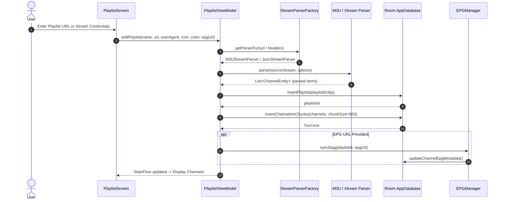
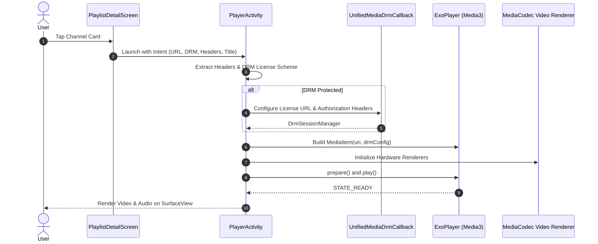
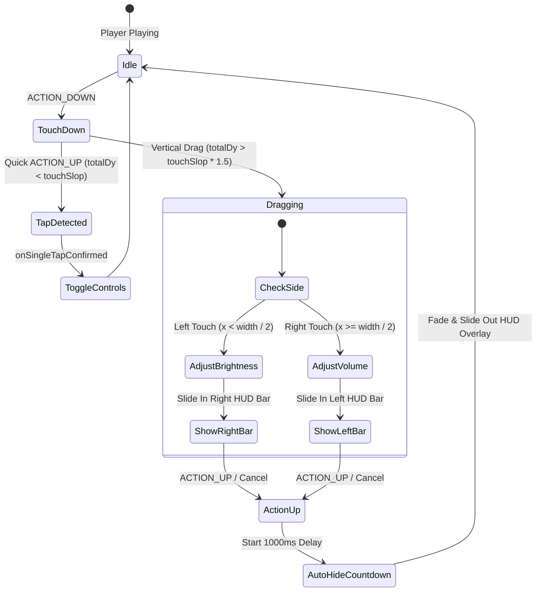

# StreamPlus Workflow & Interaction Documentation

This document describes the core execution workflows, lifecycle interactions, and state progression patterns within StreamPlus.

---

## 1. Playlist Ingestion & Persistence Workflow



### Steps:
1. **Sniffing & Detection**: The URL or input stream is evaluated by `StreamParserFactory` to select the specialized parser (M3U, JSON, PLS, or Xtream REST API).
2. **Chunked Transaction Ingestion**: Large playlists (10,000+ channels) are batched in chunks of 500 records inside a single SQLite transaction to avoid memory spikes and UI thread stutter.
3. **EPG Asynchronous Matching**: EPG schedules are pulled in the background and mapped to channels via `tvg-id` and `tvg-name`.

---

## 2. Playback Lifecycle & DRM Resolution Workflow



### Orientation & Back-Navigation Handling:
* When `PlayerActivity` starts, orientation adapts to user settings (`Auto`, `Landscape`, `Sensor`).
* When the user presses the Back button or taps Close, `BackHandler` immediately locks `requestedOrientation = SCREEN_ORIENTATION_PORTRAIT` before finishing.
* This ensures that when `MainActivity` is resumed, it renders strictly in portrait mode with zero rotation flash.

---

## 3. Touch Gesture & HUD Controls Workflow



### Key Safety & Ergonomic Mechanisms:
* **Opposite-Side HUD Feedback**:
  * Touching the **Left half** of the screen adjusts Brightness and renders the vertical indicator bar on the **Right edge** (`Alignment.CenterEnd`).
  * Touching the **Right half** of the screen adjusts Volume and renders the vertical indicator bar on the **Left edge** (`Alignment.CenterStart`).
  * **Ergonomic Advantage**: Prevents the user's hand or thumb from obstructing the visual HUD while adjusting levels.
* **Touch Slop Guard**: Micro-tremors and accidental taps (movements < `touchSlop * 1.5f` or horizontal dominance) are rejected from triggering gestures.
* **Release Debouncing & Clean Auto-Hide**: `showGestureOverlay` only initiates the 1000ms auto-hide countdown on touch release (`ACTION_UP` / `ACTION_CANCEL`), ensuring full visibility while dragging.
* **Collision Prevention**: When gesture HUDs are active, the floating lock button automatically hides to guarantee zero visual collisions.

---

## 4. Local Media & Audio Filtering Workflow

```mermaid
flowchart TD
    A[LocalScreen Launched] --> B[Check Storage Permissions]
    B -->|Granted| C[Query MediaStore ContentResolver]
    D{Filter Mode}
    C --> D
    D -->|Audio Folder View| E[Extract Audio Files]
    E --> F{filterSmallAudio Enabled?}
    F -->|Yes| G[Filter: SIZE >= 300 KB (307,200 bytes)]
    F -->|No| H[Include All Audios]
    G --> I[Decode Album Art / Thumbnails]
    H --> I
    I --> J[Display Folder & Track Grid]
    J --> K[User Taps Track]
    K --> L[Start MusicPlayerActivity / Background Service]
```

### Audio Size Management:
* Standard sound effects, voice notes, and notification rings under 300 KB are excluded by default when `filterSmallAudio` is active.
* Users can toggle the quick `[Music Only (> 300 KB)]` filter chip at any time to inspect smaller recordings with distinct tags.

---

## 5. Navigation & Back-Button Hierarchy Workflow

To guarantee zero accidental app exits and maintain intuitive navigation depth:

```mermaid
flowchart TD
    UserBack[User Presses Back Button] --> CheckContext{Current Context}

    CheckContext -->|Inside Player| ExitPlayer[Restore Portrait Orientation & Finish PlayerActivity]
    CheckContext -->|In PlaylistDetailScreen| CheckDetailState{Detail State}
    CheckContext -->|In Non-Playlist Tab| SwitchTab[Navigate to Playlists Tab]
    CheckContext -->|In Playlists Subtab (Fav/Recent)| SwitchRootTab[Switch to Playlists Tab 0]
    CheckContext -->|At Root Playlists Tab| PromptExit[Show Back Again to Exit Toast]

    CheckDetailState -->|Search Query Active| ClearSearch[Clear Search Query]
    CheckDetailState -->|Custom Group Selected| ResetGroup[Reset Group to All]
    CheckDetailState -->|Non-Live Stream Type| ResetType[Reset Type to Live]
    CheckDetailState -->|At Detail Root| PopDetail[Pop BackStack to PlaylistsScreen]
```

### Protection Guarantees:
1. **In-Playlist Layering**: In `PlaylistDetailScreen`, Back systematically unwinds state (Search -> Group Filter -> Stream Type) before popping the screen.
2. **Tab Redirection**: Pressing back on Settings, Local Media, or Multi-View cleanly returns the user to the Playlist tab rather than exiting the application.
3. **Double-Back Exit Guard**: At the app root, back prompts the user before closing the app.
